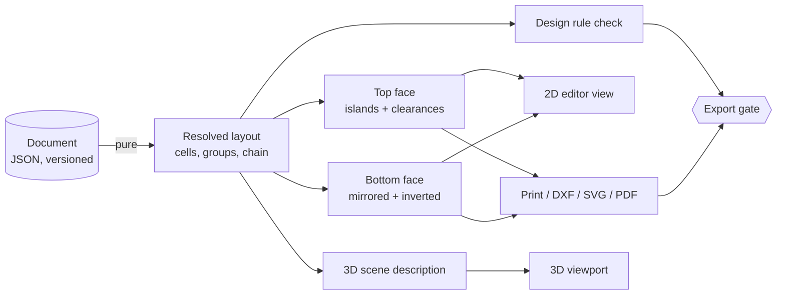

# Battery Architect — feasibility & architecture

**Status:** analysis, no code written yet
**Input:** `analysis/reference/manual-layout-1512.png` (your current manual grouping)

---

## 1. Verdict

**Yes, it is possible, and it is a much smaller problem than it looks — provided you
refuse to build a general CAD program.**

What you are describing is a **2.5D parametric layout tool with a CAM export layer**:
cells sit on a plane, everything of interest is extruded straight up or down, and the
outputs are flat cut files. There is no free-form surface modelling, no assemblies with
mates, no NURBS, no reverse engineering of imported solids. That is exactly the class of
problem where a web-tech stack is at its strongest and where a traditional CAD kernel
would be dead weight.

The genuinely hard parts are **not rendering or 3D**. They are:

| Hard part | Why | Risk |
|---|---|---|
| Deriving two *consistent* face layouts from one model | mirror axis, polarity inversion, cell identity, and the fact that the two faces are not mirrors of each other in outline | **High** — this is where cutting mistakes happen |
| Partitioning a sheet into electrically isolated islands | it is a constrained multi-label region-growing problem, not a drawing problem | **High** — this is the actual intellectual core |
| Turning coloured blobs into cut paths with kerf and tabs | geometry + process knowledge | Medium |
| Packing cells into an arbitrary outline | equal-circle packing in a polygon is NP-hard in general | Medium — solve with a lattice + manual editing, never promise optimality |

Nothing here needs research. Everything here needs care.

**Effort estimate (solo, full-time):** a genuinely useful MVP in **6–9 weeks**; the
version you would actually trust with €300 of cells in **4–6 months**. The risk is not
technical, it is *fabrication convention* — see §9.

---

## 2. What your drawing already tells me

I measured the bitmap rather than guessing, and it is more informative than you might
expect. Two zoomed crops are in `analysis/reference/`.

**Observations**

1. Both faces are **staggered (hex-ish) rows**, roughly 13 rows of 6–7 cells,
   so **≈ 90–100 cells per face**. If this is 96 cells, the natural reading is
   **24S4P** (or 16S6P / 12S8P). Your colours suggest 4–6 parallel groups per face.
2. Cells are **colour-coded**, and **polarity is mixed inside a colour group** — so
   colour is *not* polarity. Colour is almost certainly your **parallel group /
   busbar segment** identity, which is the right thing to encode.
3. Polarity `+`/`−` is drawn per cell on both faces, and it is genuinely mixed on each
   face (that is normal: cells are flipped individually so that the series chain can be
   built by welding across the two faces).
4. **The two panels disagree with each other.** On the left, circles are drawn tangent
   with a thin seam — measured pitch/diameter ≈ **1.03**. On the right, circles are
   drawn **overlapping** — measured pitch/diameter ≈ **0.82**, i.e. ~18% overlap.

Point 4 is the important one, and it is the strongest argument for building the tool:

> A physical pack cannot have the same cells both tangent and 18% overlapping. Your two
> sheets are therefore **not two views of one model** — they are two independently
> hand-drawn pictures that happen to look similar. Anything cut from the right-hand
> picture would be dimensionally wrong.

It also means the drawing carries **no trustworthy scale**, so it cannot be used for
cutting at all today. That is the gap: *you have a schematic, and you need a
dimensioned, single-source-of-truth model.*

**Design consequence:** the product's core promise should be
*"one model, every view derived"* — and the tool should make it **impossible** to have
two inconsistent face drawings, because the bottom sheet is *computed*, never authored.

---

## 3. The thing that actually makes this project worth doing

Generic drawing tools (Illustrator, Fusion, KiCad) can already place circles. The value
you are missing is **derivation and verification**:

- a busbar sheet that is *generated* from groups, with correct clearances and islands,
- a bottom sheet that is *provably* the mirror of the top with polarity inverted,
- manufacturing files with kerf, tabs, registration and a title block,
- and a **design-rule check** that refuses to export a pack with a short between
  adjacent series groups.

That last item is worth more than the drawing UI. A pack that looks fine and has one
1 mm island bridge is a fire.

---

## 4. Scope decomposition

Rate each module by *effort* (S/M/L) and *risk* (low/med/high).

| # | Module | What it does | Effort | Risk |
|---|---|---|---|---|
| 1 | **Cell library** | 18650/21700/26650/32700/4680/prismatic: diameter, height, terminal cap & vent geometry, weld zone annulus, mass, capacity, IR, max current | S | low |
| 2 | **Layout model** | cells on a plane: position, orientation (flipped or not), group id, fuse flag, serial number | S | low |
| 3 | **Arrangement engine** | hex / square / brick lattices, fill-inside-outline, keep-outs, manual add/remove, snapping | M | med |
| 4 | **Grouping** | parallel groups (colour), series chain order, auto-suggest + manual override | M | med |
| 5 | **Face derivation** | top/bottom sheets, mirror transform, polarity inversion, cell identity mapping | M | **high** |
| 6 | **Sheet generation** | islands, clearances, tabs, fuse windows, weld spots, outline, mounting holes | **L** | **high** |
| 7 | **2D view** | SVG renderer: zoom/pan, drag, colour, selection, dimensions, annotations | M | low |
| 8 | **3D view** | instanced cells, extruded sheets, holders; explode, section, toggle layers | M | low |
| 9 | **Fabrication export** | DXF/SVG/PDF at 1:1, tiling, registration, kerf compensation, layer mapping | M | med |
| 10 | **DRC** | clearance, overlap, island connectivity, tab width, short detection, print-scale check | M | med |
| 11 | **Assembly outputs** | BOM, cell map, weld schedule, mass/cost, step-by-step sheet | S–M | low |
| 12 | **Persistence** | project file (JSON), versioning, undo/redo, autosave | S | low |

---

## 5. Language and stack

### Recommendation: **TypeScript**, web-first, packaged as a desktop app later.

This is not a "web because web is trendy" answer. The specific match:

| Requirement | Why TS/Web wins |
|---|---|
| 2D vector output | SVG is native. Your cut files *are* SVG/DXF paths; no impedance mismatch. |
| 1:1 printing | The browser's print pipeline plus a proper PDF writer is the cheapest path to accurate, tiled, scaled output. Every alternative means shipping a print engine. |
| 3D preview | `three.js` / React Three Fiber is the strongest ecosystem for "instanced cylinders + extruded polygons", which is literally the whole 3D problem. |
| Geometry | `Clipper2` (WASM) gives robust offset/boolean/kerf; `earcut` triangulates; `manifold-3d` if real CSG is ever needed. Production-grade, used by CAD and CAM tools. |
| Distribution | Runs in a browser with zero install, then wraps in **Tauri** for file dialogs, local autosave and offline. |
| Testability | The geometry kernel is pure functions → headless `vitest` tests with golden files. You cannot ship cut files you can't regression-test. |

### Rejected alternatives

- **C++/Qt + OpenCASCADE** — correct for a *real* CAD product (STEP import/export, NURBS,
  fillets, assemblies). Here it is 10× the work for capability you will never use, and
  the 2D/CAM layer you actually need would still have to be written. Only reconsider if
  the tool must also design the **enclosure** as a B-rep solid.
- **Python + PySide6 + shapely** — excellent geometry libraries and the fastest path to
  a *solver-heavy* tool (thermal, electrical, optimisation). But weak 3D, painful print
  accuracy, and distribution is a problem. Keep it as a **possible later sidecar** if
  simulation becomes central.
- **Rust** — performance is not your bottleneck (~1000 cells is trivial). Thinner
  ecosystem for SVG/DXF/PDF authoring. Good later as a WASM kernel if a hot loop appears.
- **Electron** — works, but ~150 MB for nothing; Tauri gives the same file access at a
  fraction of the footprint.

### Concrete stack

```
pnpm monorepo (TypeScript strict)
├─ packages/core          domain model + operations, zero runtime deps
├─ packages/geometry      clipper2-wasm wrapper, offset/boolean/triangulate, units
├─ packages/fabrication   islands, kerf, DXF + SVG + PDF writers
├─ packages/ui            React + Vite, Zustand, Tailwind
├─ packages/three         three.js / R3F scene builders (consumes derived model)
└─ apps/desktop           Tauri shell (file system, printing, updates)
```

**Units:** millimetres as `number` (float64) everywhere in the kernel; integer
nanometres never; format at the edge only. Document the unit in the type name
(`LengthMm` branded type) — mixed units are the #1 source of silent cut errors.

---

## 6. Architecture

### 6.1 The one rule

> **The document is the only state. Every view and every file is a pure function of it.**



A `compute(document) -> DerivedModel` step, memoised by document hash, feeding four
consumers. No view owns data. Undo/redo is a stack of document snapshots (or immer
patches) — which also gives you *"what changed and did it break the DRC"* for free.

### 6.2 Data model sketch

```ts
type LengthMm = number;

interface CellType {
  id: string;                       // "21700-p42a"
  diameter: LengthMm; height: LengthMm;
  terminal: { plus: TerminalGeom; minus: TerminalGeom };  // cap, vent, weld annulus
  massG: number; capacityAh: number; nominalV: number;
  maxContA: number; internalMohm: number;
}

interface PackCell {
  id: string;                       // stable identity: survives mirroring
  typeId: string;
  x: LengthMm; y: LengthMm;         // top-face coordinates, authoritative
  flipped: boolean;                 // polarity: true => + faces down
  groupId: string;                  // parallel group
  serial?: number;                  // printed label
  fuse?: FuseSpec;
}

interface ParallelGroup {
  id: string; label: string; colour: string;
  cellIds: string[];
  seriesIndex: number;              // position in the chain, 0..N-1
}

interface Sheet {
  face: 'top' | 'bottom';
  material: MaterialSpec;           // copper C110 / nickel-plated steel, thickness, kerf
  islands: Island[];                // derived, editable override
  holes: Hole[];                    // cell clearance, mounting, vent
  outline: Polygon;                 // pack footprint, with tabs and cutouts
  registration: Fiducial[];         // 3 crosses + corner ruler
}

interface Document {
  schemaVersion: number;
  pack: { name: string; cellTypeId: string; cells: PackCell[] };
  groups: ParallelGroup[];
  sheets: { top: SheetOverrides; bottom: SheetOverrides };
  holders?: HolderSpec;
  print: { paper: 'A4'|'A3'|'A2'; tileOverlapMm: number; showDimensions: boolean };
}
```

Note `flipped` rather than storing two signs: one bit, no chance of the two faces
disagreeing.

### 6.3 The mirror problem — design it once, explicitly

This deserves its own subsystem because it is the single most expensive mistake in
sheet-metal pack building.

Define three frames, and never mix them:

1. **Model frame** — the pack as you think about it. `x` right, `y` up, `z` out of the
   top face. All cells placed here. This is the only place a cell has coordinates.
2. **Top sheet frame** — identical to model frame.
3. **Bottom sheet frame** — the bottom face *as it will lie on the cutter bed*.

The transform bottom-sheet → model is a **reflection**, not a rotation:

```
p_bottom = (W - p_model.x, p_model.y)     // reflect about the vertical centre line
```

Because you flip the sheet about its vertical axis when you put it on the pack. Then:

- a cell's **top** polarity = `flipped ? '−' : '+'`
- its **bottom** polarity = the opposite
- its **bottom position** = reflected coordinate
- its **cell id / serial** is unchanged, and the tool prints it on both faces so you can
  physically verify orientation during assembly

Three things must be visible in the UI and on the print, or you will scrap sheets:

- a large **"TOP" / "BOTTOM"** label and **"printed mirrored"** /
  **"printed as seen from below"** warning in the title block,
- **asymmetric fiducials** (not a symmetric pattern — a symmetric pattern cannot detect
  a flip),
- a **1:1 scale ruler and a 100 mm check bar** on every sheet.

Offer both print modes (`as seen from below` and `fold-over`) but default to one, and
never let the mode be implicit.

### 6.4 Generating islands — the actual core algorithm

This is where I would spend the design effort. The good news: it is a raster problem
with a vector finish, which is both fast and *naturally interactive*.

```
1. Rasterise the sheet at 0.1 mm/px (a 300×200 mm sheet = 3000×2000 px, trivial).
2. Stamp the fixed geometry:
     - cell clearance holes (diameter + 0.3–0.5 mm), 
     - weld windows (the annulus where the strip meets the can),
     - mounting holes, outline, tabs, keep-outs.
3. Seed each weld window with its group id (from the parallel-group model).
4. Grow all seeds simultaneously through free space (multi-source distance transform
   / watershed). Growth stops at holes and at the outline. Ties are resolved by
   a fixed order so the result is deterministic.
5. Optional manual paint: let the user brush extra copper or erase a bridge — the
   raster makes this natural, and the vector result is regenerated afterwards.
6. Vectorise: marching squares → Douglas–Peucker simplify (tolerance 0.02 mm) →
   Clipper2 cleanup → offset by kerf.
7. Connect islands that are adjacent in the series chain with explicit tabs.
8. Validate: each island is one connected component; no two islands of *different*
   groups touch; every island has ≥ N weld windows; every tab ≥ minimum width.
```

Why raster-then-vector: the partitioning is a global constraint (you cannot decide an
island's shape locally), and watershed solvers on a grid are ~50 lines, deterministic,
and fast enough to re-run live while dragging a cell. The vector step gives clean,
cut-ready outlines. It also means a user can paint an island with a brush — which is how
people actually think about busbars.

Do **not** try to solve this with polygon boolean operations alone; it becomes a
combinatorial mess the moment the outline is irregular.

### 6.5 Series chain

Groups are nodes; the chain must visit every group exactly once (a path, not a cycle).
Auto-suggest with a nearest-neighbour tour over group centroids refined by 2-opt, then
present it as a **draggable ordered list** — the user almost always has a preferred
physical order. The geometry is only valid when every consecutive pair in the list is
actually bridged by a tab on some sheet; the DRC checks that, and the UI highlights the
first broken link.

### 6.6 3D

Straightforward, and *not* where the effort goes:

- cells → one `InstancedMesh` of a capped cylinder per cell type (1000 cells is nothing);
- sheets → `ExtrudeGeometry` from the *same* island polygons used for export, so 3D
  cannot drift from the cut file;
- holders → extruded plate with holes, or a generated STL/STEP for printing;
- views: exploded layers, cross-section, per-group isolation, polarity tint.

Use one scene builder fed by the derived model. Do not model the cells twice.

---

## 7. Fabrication outputs

| Format | Use | Notes |
|---|---|---|
| **DXF** (R12 + 2013) | laser/waterjet/CNC, send to a cutter | layer per operation: `OUTLINE`, `HOLES`, `TABS`, `ENGRAVE`, `FIDUCIAL`; closed polylines only; mm; no blocks |
| **SVG** | LightBurn, vinyl cutters, quick checks | 1 user unit = 1 mm, explicit `viewBox`, no CSS |
| **PDF** 1:1 | manual cutting, workshop print | tiled across A4/A3 with overlap + registration; **never** "fit to page" |
| **STL/STEP** | printed holder, enclosure hand-off | later |

Rules that must be enforced by the exporter, not by the user:

- **Kerf:** offset the outline inward by `kerf/2`; keep the *nominal* geometry in the
  document and apply the offset only at export (with the value shown in the title block).
- **No scaling:** emit a 100 mm calibration bar; the DRC can't check a printed sheet, but
  you can ask the user to measure it once and store the printer's scale error.
- **Tabs:** minimum width driven by current (see below) and by the cutter's min feature.
- **Registration:** three asymmetric crosses + sheet ID + revision + date.
- **Layer separation** so the operator can turn engraving off.

### Current-carrying sanity checks (cheap, high value)

You already know the physics; the tool should compute it so you don't have to:

- tab/window **current density** in A/mm² for the chosen sheet thickness,
- **voltage drop** along the busbar from sheet resistivity (copper ~1.72e-8 Ω·m,
  nickel-plated steel ~7× worse — this is exactly why one face is copper and the other
  is nickel-plated steel: galvanic compatibility with the aluminium can on the negative
  side, and cost on the positive),
- per-cell **fuse wire** sizing if you fuse individual cells,
- weld spot **count and pitch** per cell (typical 4–8 spots on 0.15–0.3 mm strip).

---

## 8. Design rule check (the export gate)

Ship this early; it is the feature that makes the tool trustworthy.

| Rule | Severity |
|---|---|
| two islands of different series groups closer than `minGap` | **error** — short |
| island not connected (fragmented by a hole/keep-out) | **error** |
| cell clearance overlaps a neighbouring cell or the outline | **error** |
| tab narrower than `max(minFeature, currentRule)` | **error** |
| group has no weld window on the required face | **error** |
| series chain has a missing or duplicate group | **error** |
| cell count ≠ declared S×P | warning |
| cell too close to pack edge for holder wall | warning |
| island thinner than 2× kerf anywhere | warning |
| bottom sheet is not the exact reflection of the top | **error** (internal invariant) |

The last one is an *internal* assertion, not a user rule — it should be impossible to
violate, and testing it is how you prove the mirror subsystem works.

---

## 9. The real risks (and what to do about them)

1. **Fabrication conventions, not code.** Which face is copper, what kerf your cutter
   actually produces, how much clearance your holder needs, whether the tabs survive
   handling. **Mitigation:** before building the full app, cut *one* small sheet
   (4×4 cells) from generated DXF and fit it. Build the "cut → fit → correct" loop in
   week 2, not month 4.
2. **Mirror/polarity errors.** The most expensive possible bug, and the one users will
   not catch by eye. **Mitigation:** the invariant test above, asymmetric fiducials,
   printed cell numbers on both faces, and a "flip simulation" view.
3. **Scope creep into CAD.** One request for "rounded corners with a proper fillet and
   a STEP export for the enclosure" and the project doubles. **Mitigation:** fixed
   primitive vocabulary (circle, rounded rect, polygon, offset), and export 2D only.
4. **Packing expectations.** Users will expect the tool to "find the best arrangement".
   Equal-circle packing is NP-hard. **Mitigation:** lattice fill + manual editing +
   a "compact" button, and say so in the UI.
5. **Print scale drift.** Browsers and printers round. **Mitigation:** PDF writer in mm
   with no rasterisation, plus the calibration bar.

---

## 10. Suggested build order

| Milestone | Contents | Outcome |
|---|---|---|
| **M0 — spike (2–3 days)** | Cell type + hex fill in a polygon, SVG render, DXF out, 1:1 PDF. No UI polish. | proves the export chain end-to-end |
| **M1 — the model** | Document schema, undo/redo, cell library, manual placement, groups, polarities | you can rebuild your current drawing *dimensionally* |
| **M2 — derivation** | bottom face mirror + inversion, cell identity, invariant tests | the class of bug you have today becomes impossible |
| **M3 — sheets** | island generation, clearance, tabs, weld windows, kerf, DRC gate | first cuttable output |
| **M4 — 3D** | instanced cells, extruded sheets, explode/section | design review in 3D |
| **M5 — workshop** | BOM, weld schedule, assembly steps, holder STL, print tiling | replaces your current workflow |

I would not build M4 before M3. 3D is the most visible feature and the least valuable
one; it will happily consume a month and produce no cuttable sheet.

---

## 11. Two things worth adding that you did not ask for

1. **Import your existing drawing.** The bitmap you sent is the input. Even a rough
   semi-automatic importer (detect cells, snap to a lattice, assign colours to groups,
   then let the user fix everything) turns "retype 96 cells" into "review 96 cells".
   It is maybe two days of work and it is what makes the tool adoptable — including by
   *you*, on this very pack.
2. **Print the assembly map, not just the cut sheets.** A single page with both faces,
   cell numbers, group colours, and the series order is what you actually hold in your
   hand while welding. It is nearly free to generate and it prevents most build errors.

---

## 12. Bottom line

- **Possible:** yes. No research unknowns; the hard parts are engineering discipline.
- **Language:** TypeScript, pnpm monorepo, React + Vite UI, three.js for 3D,
  Clipper2 (WASM) for geometry, Tauri for desktop packaging later.
- **Architecture:** one versioned JSON document → one pure `compute()` → four consumers
  (2D editor, 3D, DRC, CAM export). Never author the bottom sheet; derive it.
- **Core algorithm:** raster watershed for islands, vector for output.
- **Biggest danger:** not code — cutting conventions. Cut a 4×4 test sheet in week 2.

If this direction is right, the next concrete step I would take is **M0**: a 200-line
spike that takes a cell type and a polygon, generates a hex fill, and emits DXF + 1:1
PDF, so you can cut a test coupon and validate kerf and clearance before any UI exists.
